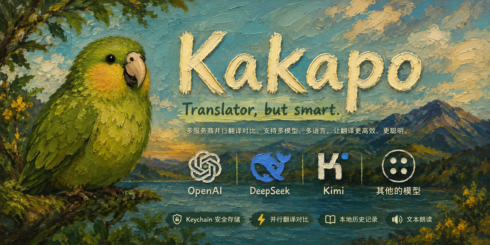
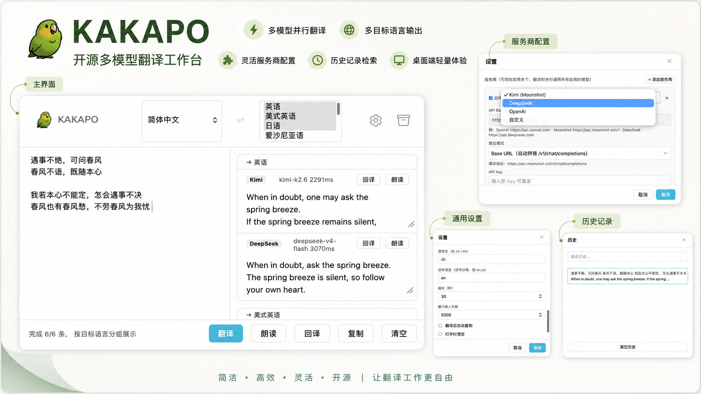
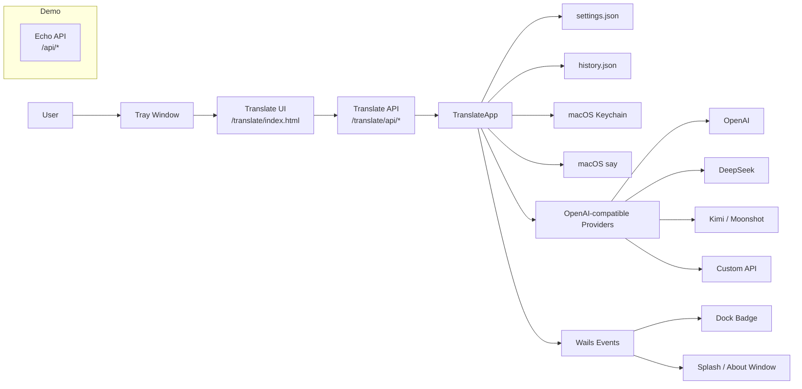
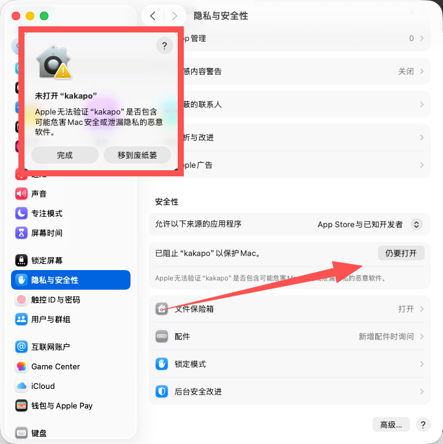

<p align="center">
  

  
</p>

<h1 align="center">Kakapo</h1>

<p align="center">
  <strong>Translator, but smart.</strong><br />
  更聪明的跨语言桌面翻译器：多服务商、多模型、多目标语言并行对比，API Key 安全存入系统密钥链。
</p>

<p align="center">
  <a href="https://github.com/soulteary/kakapo/actions/workflows/ci.yml">
    
  </a>
  <a href="https://github.com/soulteary/kakapo/blob/main/LICENSE">
    
  </a>
  
  
  
  
  <a href="./.github/go-test-report.md"></a> <a href="./.github/goreportcard-report.md"></a>
  
</p>

---

## Kakapo 是什么？



Kakapo 是一款开源桌面翻译应用，核心目标不是“调用一次模型给一个答案”，而是把翻译变成可比较、可回放、可迭代的工作流。

它可以对接 OpenAI 兼容的 `Chat Completions` 接口，例如 Kimi / Moonshot、DeepSeek、OpenAI 或你自己的兼容服务；翻译时可同时启用多个服务商、多个模型、多个目标语言，并将结果并行展示，方便你快速比较风格、准确性与延迟。

Kakapo 也是一份完整的 [Wails v3](https://v3alpha.wails.io/) 桌面应用工程参考，覆盖托盘窗口、启动页、应用菜单、主进程事件、本地配置、历史持久化、系统朗读、内置 Echo API 等常见桌面应用能力。

> 适合：高频翻译、模型效果对比、本地桌面工具开发、Wails v3 工程学习与二次开发。

---

## 功能亮点

| 能力 | 说明 |
| --- | --- |
| 多语言互译 | 支持源语言、目标语言自由配置，可一次翻译到多个目标语言 |
| 多服务商管理 | 支持 OpenAI 兼容接口，可配置 Kimi / Moonshot、DeepSeek、OpenAI、自定义服务 |
| 并行翻译对比 | 按 `服务商 × 模型 × 目标语言` 并行执行（并发上限 6），便于横向比较输出质量与速度 |
| 模型参数适配 | 针对模型族自动调参：`kimi-k2` 系列省略 `temperature`、`thinking=disabled` 并放大 `max_tokens`；`deepseek-reasoner` / `deepseek-r1` 省略 `temperature`、`reasoning_effort=high`、`thinking=enabled`；`deepseek-chat` / `deepseek-v3` 等普通模型仍发送 `temperature` |
| 端点模式 | 每个服务商可选 `base`（自动追加 `/v1/chat/completions`）或 `full`（按原样使用完整 URL） |
| API Key 安全存储 | 每个服务商的 API Key 独立保存到系统 Keychain（账号名为 Provider ID），不写入 `settings.json` |
| 本地翻译历史 | 历史记录本地持久化，支持搜索、清空与结果回放 |
| 文本朗读 | macOS 下基于系统 `say` 命令按语言朗读文本（单条上限 5000 字，非 macOS 返回 501） |
| 桌面体验 | 支持托盘窗口、启动页、About 窗口、应用菜单、Dock Badge（未读翻译角标）等桌面交互 |
| 工程参考 | 内置 Echo API、Wails Service 挂载、多页面 Vite 构建、定时事件机制示例 |

---

## 预览

<!--
建议补充真实截图后开启：

<p align="center">
  
</p>
-->

```text
输入文本
   │
   ├─ Provider A / Model 1 ── English
   ├─ Provider A / Model 2 ── English
   ├─ Provider B / Model 1 ── 日本語
   └─ Provider C / Model 1 ── Français

输出结果并行返回，可比较质量、风格、延迟与错误信息。
```

---

## 技术栈

| 层级 | 技术 |
| --- | --- |
| 桌面框架 | Wails v3 / Go / 原生 WebView |
| 后端服务 | Go 1.27.3、Echo v4、Wails Service |
| 前端 | Vite 8、原生 JavaScript、多页面构建 |
| 任务编排 | Task（`Taskfile.yml`） |
| 依赖管理 | Go Modules、Bun |
| 配置存储 | 用户配置目录下的 `settings.json` |
| 密钥存储 | macOS Keychain（`internal/secrets`） |
| 朗读能力 | macOS `say`（`internal/speech`） |

---

## 安装

### Homebrew（macOS，推荐）

Kakapo 已发布到 [soulteary/homebrew-tap](https://github.com/soulteary/homebrew-tap)，macOS 用户可直接通过 Homebrew Cask 一键安装：

```bash
# 添加 Tap（仅需一次）
brew tap soulteary/tap

# 安装 Kakapo（macOS universal）
brew install --cask soulteary/tap/kakapo
```

升级与卸载：

```bash
# 升级到最新版本
brew upgrade --cask kakapo

# 卸载
brew uninstall --cask kakapo

# 移除 Tap（可选）
brew untap soulteary/tap
```

> Cask 版本为 macOS universal 安装包，安装后可在启动台或应用程序中直接打开。若首次打开遇到「无法验证开发者」提示，请参考文末的 [软件无法打开](#常见问题软件无法打开) 说明。

如果你希望从源码构建或参与开发，请继续阅读下面的「快速开始」。

---

## 快速开始

### 1. 克隆项目

```bash
git clone https://github.com/soulteary/kakapo.git
cd kakapo
```

### 2. 准备环境

需要安装：

- Go `1.27.3`
- [Bun](https://bun.sh/)
- Wails CLI：`wails3`
- Task：`task`

推荐在 macOS 上开发和运行。项目中 Keychain、系统朗读、打包流程等能力以 macOS 为优先平台；其他平台的部分能力可能降级或不可用。

### 3. 安装前端依赖

```bash
task common:install:frontend:deps
```

### 4. 开发模式运行

```bash
task dev
```

### 5. 构建与运行

```bash
task build
task run
```

### 6. 打包应用

```bash
task package
```

可选：构建通用二进制并打包（macOS）：

```bash
task darwin:build:universal
task darwin:package:universal
```

> `task build` / `task package` 会根据当前系统调用对应的 Taskfile 命名空间。若你的分支尚未包含某个平台的构建任务，请先补齐相应平台 Taskfile。

---

## 如何配置翻译服务商？

进入应用的设置页后，为每个服务商配置：

| 字段 | 说明 |
| --- | --- |
| Provider ID | 服务商唯一标识，同时用作 Keychain 账号名（留空时自动生成） |
| Type | 服务商类型，例如 `openai`、`deepseek`、`kimi` 或 `custom`（仅用于 UI 提示） |
| Base URL | OpenAI 兼容接口地址 |
| Endpoint Mode | `base`（自动追加 `/v1/chat/completions`）或 `full`（按原样使用完整 URL） |
| Models | 可用模型列表 |
| Enabled | 是否参与翻译 |
| API Key | 写入系统 Keychain，不会明文返回前端 |

默认配置内置一个 Kimi / Moonshot 服务商（`https://api.moonshot.cn/v1`，模型 `kimi-k2.6`）。翻译时，Kakapo 会读取所有启用服务商及其全部模型，并按目标语言并行请求上游接口。

其他默认值：源语言 `zh`、目标语言 `en`、超时 `30s`、`temperature` `0.2`、最大输入 `5000` 字。

---

## 数据与隐私

默认数据位于系统用户配置目录（`os.UserConfigDir()`）下的 `Kakapo` 子目录。

macOS 常见路径：

```text
~/Library/Application Support/Kakapo/settings.json
~/Library/Application Support/Kakapo/history.json
```

数据说明：

| 数据 | 位置 | 说明 |
| --- | --- | --- |
| 应用设置 | `Kakapo/settings.json` | 保存语言、模型、超时、`temperature`、输入限制、自动复制等配置 |
| 翻译历史 | `Kakapo/history.json` | 保存本地翻译记录 |
| API Key | 系统 Keychain | 不写入配置文件，不明文返回前端 |

注意：翻译文本会发送给你启用的上游模型服务。请不要输入不适合发送给第三方服务的敏感内容。

历史初始化失败时，读取、保存和清空均返回错误，不将不可用状态报告为空或已清空。修复配置目录或存储故障后，下一次操作会重试初始化，无需用删除记录来恢复。

清空历史仅删除当前配置目录中的 `history.json`。文件原本不存在时视为成功；删除失败时返回错误，不能把界面操作完成当作数据已删除。请检查目录权限、只读挂载或存储故障，再重试并核对文件状态。它不会清理备份、导出副本或上游服务记录，也不保证安全擦除磁盘内容。

本轮删除错误处理不改变历史格式，不需要迁移或新增持久卷，允许回滚到旧版本；但旧版本仍可能将删除失败报告为成功。配置目录应由单个应用实例使用，当前没有跨进程文件锁。


---

## API 概览

Kakapo 将翻译页面与翻译 API 通过 Wails Service 挂载在 `/translate` 下。

> 这些路由由 Wails 的内部 AssetServer 在 WebView 中提供，前端以**相对路径**调用（见 `frontend/src/projects/translate/translate-api.js`），桌面运行时不对外暴露固定 HTTP 端口，因此无法直接用 `curl` 访问。

| 方法 | 路径 | 说明 |
| --- | --- | --- |
| `POST` | `/translate/api/translate` | 执行翻译，支持多目标语言、多模型并行 |
| `GET` | `/translate/api/settings` | 读取设置，API Key 只返回是否已设置与脱敏信息 |
| `PUT` | `/translate/api/settings` | 保存设置，可写入或清空服务商 API Key |
| `GET` | `/translate/api/history` | 获取历史记录，支持 `q` 搜索 |
| `POST` | `/translate/api/history` | 写入翻译历史 |
| `DELETE` | `/translate/api/history` | 清空历史记录 |
| `POST` | `/translate/api/speak` | 朗读文本，macOS 使用 `say` |
| `POST` | `/translate/api/splash` | 请求主进程显示 About / Splash 窗口 |

翻译请求体示例（前端实际通过 `fetch` 调用）：

```js
await fetch('/translate/api/translate', {
  method: 'POST',
  headers: { 'Content-Type': 'application/json' },
  body: JSON.stringify({
    text: '你好，世界',
    sourceLanguage: 'auto',
    targetLanguages: ['English', '日本語'],
    models: ['gpt-4o-mini'],
  }),
});
```

项目还包含示例 Echo API，通过 Wails Service 挂载在 `/api`：

| 方法 | 路径 | 说明 |
| --- | --- | --- |
| `GET` | `/api/info` | 示例信息接口 |
| `GET` | `/api/users` | 示例用户列表 |
| `GET` | `/api/users/:id` | 示例用户详情 |
| `POST` | `/api/users` | 示例创建用户 |
| `DELETE` | `/api/users/:id` | 示例删除用户 |

---

## 架构概览



---

## 目录结构

```text
kakapo/
├── assets/
│   ├── icon.png
│   └── icon-active.png
├── build/
│   ├── config.yml                 # Wails 配置
│   ├── Taskfile.yml               # 公共构建任务
│   └── darwin/Taskfile.yml        # macOS 构建/打包任务
├── frontend/
│   ├── src/projects/app/          # 启动页 / 示例页面
│   ├── src/projects/translate/    # 翻译页面
│   ├── scripts/                   # 多页面构建脚本与定义
│   └── package.json
├── internal/
│   ├── config/                    # settings.json 读写
│   ├── history/                   # 翻译历史
│   ├── secrets/                   # Keychain 抽象与实现
│   ├── speech/                    # macOS say 与跨平台 stub
│   ├── translate/                 # OpenAI 兼容翻译客户端
│   └── wails/                     # tray / menu / splash / events
├── pkg/echo/                      # Echo 与 Wails Service 适配
├── appinfo.go                     # 应用元信息服务 AppInfoService
├── main.go                        # Wails app 主入口
├── server.go                      # Echo 示例服务（/api）
├── server_translate.go            # 翻译页面与 REST API
├── translate.go                   # 翻译业务核心 TranslateApp
├── Taskfile.yml
└── README.md
```

---

## 当前构建元信息

`build/config.yml` 当前已配置为项目实际信息：

- `companyName`：`soulteary.com`
- `productName`：`Kakapo`
- `productIdentifier`：`com.soulteary.kakapo`
- `description`：`Translator, but smart`
- `version`：`0.0.1`

这些是 `build/config.yml` 的模板字段；现有 `build/darwin/Info.plist` 的 Bundle 版本为 `0.1.0`。About 页的发布版本、源码提交与构建时间由构建任务注入 `AppVersion` / `AppCommit` / `AppBuildTime`，日历发布标签与模板中的 `0.0.1` 不是同一字段。

---

## 常用开发命令

```bash
# 安装前端依赖
task common:install:frontend:deps

# 开发模式
task dev

# 生成前端绑定
task common:generate:bindings

# 构建前端
task common:build:frontend

# 更新 Wails build assets
task common:update:build-assets

# 许可证头检查 / 自动补全
task common:license:check
task common:license:add
```

当前仓库只提供 macOS 原生构建与打包任务，没有 `common:build:server`、`common:run:server` 或 Docker 构建/运行任务。内部 AssetServer 不应据此当作独立部署的 HTTP 服务。

Linux 用于后端构建、静态检查和测试，需要 `libgtk-4-dev`、`libwebkitgtk-6.0-dev`、`libsoup-3.0-dev` 及 C 编译工具链。后端验证时可按 CI 为 `frontend/dist/app/index.html` 和 `frontend/dist/translate/index.html` 创建占位资源，以满足 `go:embed`；占位资源不能用于发布。非 macOS 的 Keychain 是不持久化密钥的兼容 stub，朗读返回不支持；仓库不发布 Linux 桌面包。

访问日志默认启用，可设置 `KAKAPO_HTTP_LOG=0`、`false`、`off` 或 `no` 关闭（忽略大小写及首尾空白）。该变量不关闭业务错误或启动日志；日志输出不应包含凭据或敏感正文。访问日志记录静态路由模式，未知路径和方法使用固定标记，不记录实际路径参数或查询正文；未提交响应的错误按 Echo 错误状态分类，错误仍交给原处理链。

后端常用检查：

```bash
gofmt -w .
go vet ./...
go test ./...
go build ./...
```

---

## 开发注意事项

- 修改导出给前端的 Go 方法后，执行 `task common:generate:bindings`。
- 修改 `build/config.yml` 中的 `info` 或 `fileAssociations` 后，执行 `task common:update:build-assets`。
- 不要提交 API Key、`settings.json`、`history.json` 或其他敏感文件。
- 平台相关能力建议使用 build tags 拆分实现（参考 `internal/secrets`、`internal/speech`），保证非 macOS 平台至少可编译或明确降级。
- 示例事件日志不记录任意前端正文；JSON 解码失败返回固定错误，不反射请求字段值。
- 上游错误正文可能回显 API Key 或输入内容。翻译客户端仅保留错误类型与 HTTP 状态，不再将上游错误正文、异常成功响应正文、底层网络或读取错误详情写入诊断；正常成功的译文仍按既有方式返回。

---

## 设置与凭据更新恢复

修改、清空或删除服务商凭据前，应用先将待处理的 Provider ID 写入 `settings.json` 的 `pendingCredentialIDs` 并同步持久化，再修改 Keychain，最后提交新设置并清除该字段。标记不包含 API Key。标记非空时，单条和并行翻译均暂停；`GET /translate/api/settings` 仍可读取恢复信息，待确认卡片带 `apiKeyNeedsConfirmation`，顶层返回 `pendingCredentialIDs`。

原实现先修改 Keychain，再保存配置。如果同时更改端点和密钥且配置提交失败，后续请求可能将新密钥发送给旧端点。修复后，配置与凭据在同一进程中作为一致快照读取，网络请求不持有设置锁；已取到旧快照的请求仍使用旧端点与旧密钥。同步失败、后端操作已生效但确认丢失、或进程退出后，待恢复状态都会保留，不能只删除标记来恢复翻译。

恢复时先停止其他实例并排除存储或 Keychain 故障，再打开设置。已存在卡片显示的是上次已提交的地址，并不自动恢复未完成的目标修改；先人工确认目标端点，再重新输入或清空待确认的 API Key，或者明确移除该服务商后保存。未完成新增项会显示待恢复卡片，需要重新填写目标与模型，或移除该项。每个待处理身份都必须完成确认或删除；删除失败仍保留暂停状态。保存成功后核对待处理列表已空，再恢复翻译。

健康的旧设置不需要迁移，Keychain 账号仍是 Provider ID。新建卡片在重试时复用同一 Provider ID；直接调用 API 的客户端也应复用身份，失败后先读取待恢复状态，不能通过更换 ID 或删记录绕过恢复。重复 ID、无效旧 ID 和非有限温度会在修改凭据前被拒绝。损坏的旧配置应从已核对的备份修复，不会被静默覆盖。

升级时先停止旧应用并等待在途请求结束，保护并备份配置目录，同时记录通过安全方式核对过的端点与凭据对应关系。所有版本都只允许单实例使用同一配置目录；旧版不识别待恢复标记，禁止混合运行。只在标记为空且端点/凭据对应关系已确认时回滚；不能仅恢复旧 JSON 或删除标记，若凭据已经变化，必须同时恢复正确的对应凭据。原生 macOS Keychain 仍依赖系统解锁与授权；Linux 测试中的内存/文件凭据替身不代表原生 Keychain 已完成集成验证。原生合成凭据验证入口为 [.github/scripts/check-native-storage.sh](.github/scripts/check-native-storage.sh)；它使用独立测试命名空间，不读取应用的真实凭据。CI 与发布流程执行该入口，原生检查失败会阻止打包或发布；发布前仍需核对对应源码的实际结果。原生验证覆盖真实 Keychain 基本操作和文件同步，不代表已验证用户会话中的锁定、授权弹窗或 GUI 交互。

---

## 持久化写入与故障恢复

设置和历史先写入同目录的私有临时文件，同步文件后再原子替换目标并同步目录。替换前的写入、同步、关闭或重命名失败会保留旧文件；目标为符号链接、非普通文件或无所有者写权限时拒绝写入。文件格式不变，但替换会创建新 inode，既有 ACL、扩展属性及硬链接不会随旧 inode 自动迁移。

如果错误明确包含 `file replacement committed; directory sync failed`，新文件已经可见，但崩溃后的持久性尚未确认。先核对当前设置或历史，再决定恢复操作；不要盲目重试追加历史，以免重复记录。该错误不会自动回滚已经完成的替换。

升级前停止应用、备份并核对配置目录，将需要保留的符号链接目标人工转换为私有普通文件。目录必须可写，文件系统须支持同目录原子替换和文件/目录同步，并留出同时容纳旧文件和新文件的空间。若自行挂载存储，应持久化整个 `Kakapo` 目录，不能只把单个 JSON 文件作为挂载点。

进程在替换前被终止可能留下 `.kakapo-*.tmp` 私有文件，其中可能有配置或翻译内容；不会自动将它们当作已提交记录恢复。停止所有实例后人工核对这些文件，按备份和保留策略处理，不能在写入期间清理。清空历史只处理 `history.json`，不会清理临时文件、备份或导出副本。混合版本及回滚虽然可读取相同 JSON，但旧版仍会原地写入并可能在故障下截断文件；当前仍不提供跨进程锁；配置与 Keychain 的多步骤更新通过持久待恢复状态失败关闭，不是跨存储原子事务。

---

## 错误诊断与升级隐私要求

客户端的 `APIError.Kind`、`Status` 和 `errors.Is` 行为保持不变。`Detail` 字段为源码兼容保留，但新错误不再填入上游正文，错误格式化也忽略旧调用方设置的 `Detail`。界面仍显示按错误类型生成的提示；依赖原始上游报错文本的排障流程需要改为核对 HTTP 状态和服务商控制台，不能要求用户粘贴密钥或敏感正文。异常 URL 返回配置错误；网络和响应读取失败返回对应错误类型，不包含底层错误原文。

此变更不改变成功翻译协议、配置或历史文件格式，不需要数据迁移或新增持久卷。升级前停止应用，备份并限制配置目录访问，再替换应用；使用同一目录时只运行一个实例。旧版可以读取正常记录，但不识别凭据待恢复标记；混合运行被禁止，回滚须先按前述恢复流程核对空标记及端点/凭据对应关系，且会恢复旧版的错误透传行为。

历史记录、历史日志及备份不会自动改写。若旧版保存了包含凭据或敏感输入的上游错误：限制现有记录、日志和导出副本的访问；依据保留要求检查并清理这些副本；对已暴露的 API Key 进行轮换。不要把删除当前历史文件等同于清理了备份、日志、导出或上游服务留存内容。本轮仅收紧翻译客户端的错误诊断，不对现有记录做自动脱敏，也不改变成功译文的存储策略。

---

## 常见问题：软件无法打开



如果打开软件遇到类似【未打开“kakapo”】的问题，

> Apple无法验证“kakapo”是否包含可能危害 Mac 安全或泄漏隐私的恶意软件。

打开“系统设置”，在安全选项卡中选择“仍要打开”应用即可。

---

## 候选路线图

- [ ] 增加全局快捷键呼出翻译窗口
- [ ] 支持术语表 / 固定译法
- [ ] 支持流式翻译结果展示
- [ ] 增加 Windows / Linux 密钥存储后端
- [ ] 增加翻译结果收藏与导出
- [ ] 发布签名后的 macOS 安装包
- [ ] 增加更多模型参数适配策略

---

## 贡献

欢迎提交 Issue 和 Pull Request。贡献方式、本地开发与代码规范见 [CONTRIBUTING.md](CONTRIBUTING.md)。

建议在较大的功能或破坏性改动前先开 Issue 讨论方案。提交前请确认：

```bash
gofmt -w .
go vet ./...
go test ./...
go build ./...
task common:license:check
```

提交信息建议使用约定式提交，例如：

```text
feat: 新增全局快捷键呼出翻译窗口
fix: 修复历史记录搜索结果排序问题
docs: 更新服务商配置说明
```

---

## 许可证

Kakapo 基于 [Apache License 2.0](LICENSE) 开源，允许自由使用、修改、商用与再分发（含闭源分发）。

再分发或基于本项目衍生时，请遵守许可证要求：保留版权与许可声明、随附 [NOTICE](NOTICE) 中的署名信息，并对修改过的文件作出「已修改」标注，以引用并声明 Kakapo 项目为来源。

> 版权所有 © 2026 Su Yang (soulteary)。
